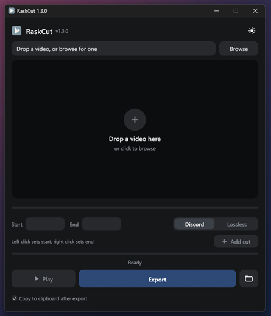

# RaskCut

**From game clip to Discord in seconds.**

Fast game clip cutter for Discord, written in Rust. Your GPU already saves the moment. RaskCut turns it into a clip you can paste straight into Discord, small enough for a free account. No Nitro, no upload sites, no video editor to learn.

  

## Why RaskCut

- **Fast.** Written in Rust. Opens instantly, scrubs instantly, exports in seconds. Uses your GPU for encoding when it can (NVIDIA, AMD or Intel).
- **Always fits Discord.** Discord mode squeezes every clip under 10 MB, the free upload limit, and picks the best resolution and frame rate for the length of the clip.
- **Ready to paste.** The finished clip is copied to your clipboard. Open Discord, press Ctrl+V, done.
- **Lossless when you want to keep it.** Lossless mode cuts on the exact frame and keeps the original quality and every audio track (game, mic, voice chat).

Works with clips from NVIDIA Instant Replay, AMD Adrenalin, OBS replay buffer, Steam and Xbox Game Bar. Supports MP4, MKV, MOV, AVI, WMV, FLV and WebM.

## How it works

1. Drop a clip into RaskCut, or right-click it and choose **Open with**.
2. Drag the handles to pick the moment. Scrub the preview to find it.
3. Want a highlight reel? Click **Add cut** for each moment. They play and export as one video.
4. Pick **Discord** or **Lossless** and click **Export**. Then paste it into Discord.

## Install

Download `RaskCut-Setup-x.y.z.exe` from [Releases](https://github.com/Muldfox/RaskCut/releases/latest) and run it. Everything is included, and the installed version updates itself.

Windows may say "Windows protected your PC". Click **More info** and then **Run anyway**.

Prefer no installer? Grab the portable zip from the same page, unzip it anywhere and run `RaskCut.exe`.

## Build from source

1. Install Rust from https://rustup.rs
2. `cargo build --release`
3. Put `ffmpeg.exe`, `ffprobe.exe` and `ffplay.exe` next to `target/release/RaskCut.exe`

## License

Video processing is done by [FFmpeg](https://ffmpeg.org), which is bundled under the GPL. Its license and source code information are in the `licenses` folder of the installation.

*Rask is Swedish for quick.*
